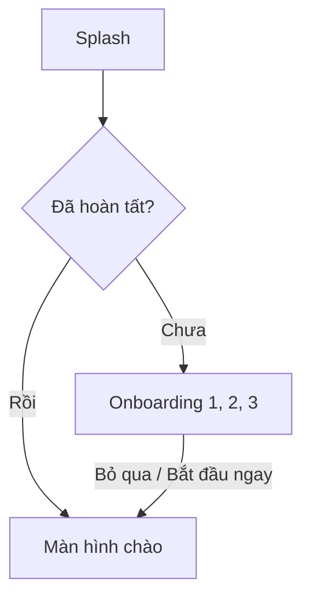

# UTH Todo — BTVN 01: Navigation và OOP

Ứng dụng Android Kotlin + Jetpack Compose cho bài tập Navigation và OOP. Phạm vi hiện tại gồm Splash, ba trang onboarding và màn hình chào trước đăng nhập.

**Trạng thái:** đã triển khai mã và bộ kiểm thử. Build, unit test và UI test chưa được xác nhận thành công vì môi trường thực thi chặn cache/Gradle daemon và kết nối ADB. Xem [báo cáo BTVN 01](docs/BTVN01-REPORT.md) trước khi nghiệm thu.

## Chức năng

- Splash xanh UTH Todo, logo checklist, khẩu hiệu và phiên bản lấy từ `BuildConfig.VERSION_NAME`.
- Ba trang giới thiệu: quản lý mọi việc, nhóm Học tập/Cuộc sống, nhắc đúng lúc.
- Nút Tiếp tục, Bỏ qua, Bắt đầu ngay; hỗ trợ vuốt ngang và Back về trang trước.
- Giữ trang đang xem qua saved state; chỉ lưu hoàn tất sau Bỏ qua/Bắt đầu ngay.
- DataStore Preferences lưu trạng thái hoàn tất; mở lại đi tới màn hình chào.
- Màn hình chào có Google và dùng thử, hiện thông báo chức năng sẽ được nối ở BTVN 02.
- Nội dung có vùng cuộn, safe insets, bố cục cuộn toàn màn hình khi chiều cao thấp/font lớn, nhãn truy cập và vùng chạm tối thiểu theo Material.

## Luồng điều hướng



Splash bị xóa khỏi Back stack khi chọn điểm đến. Khi hoàn tất onboarding, toàn bộ luồng giới thiệu cũng bị xóa khỏi stack. Back ở màn hình chào thực hiện hành vi thoát thông thường của Android.

## Cấu trúc và OOP

Các đường dẫn sau nằm trong `app/src/main/java/com/example/uth_todo/`.

| Thành phần | Trách nhiệm |
|---|---|
| `MainActivity.kt` | Activity duy nhất, cài system splash, tạo ViewModel và nội dung Compose |
| `navigation/AppDestination.kt` | Sealed class tập trung các destination |
| `navigation/UthTodoApp.kt` | NavHost, xử lý Back stack, system bar và Snackbar |
| `model/OnboardingPage.kt` | Data class nội dung và enum chọn minh họa cho ba trang |
| `data/preferences/OnboardingPreferences.kt` | Đóng gói DataStore, đọc/ghi cờ hoàn tất |
| `ui/onboarding/OnboardingViewModel.kt` | StateFlow tải/lưu/hoàn tất/lỗi, timeout và chặn bấm lặp |
| `ui/onboarding/OnboardingScreen.kt` | Pager có saved state, BackHandler và các callback |
| `ui/splash/`, `ui/welcome/` | Các màn hình Splash và chào |
| `ui/components/` | Logo, header, nút chính và minh họa Compose offline |
| `ui/theme/` | Màu thương hiệu, typography, theme sáng |

UI nhận dữ liệu và callback, không tự mở DataStore hay gọi NavController. Ví dụ `onComplete` được ViewModel xử lý lưu; NavHost chỉ chuyển sang màn hình chào khi trạng thái xác nhận thành công.

## Cấu hình và chạy

Giữ cấu hình khởi tạo: package `com.example.uth_todo`, minSdk 24, compileSdk/targetSdk 37, AGP 9.4.1, Gradle 9.6.0, Kotlin Compose plugin 2.2.10, versionName 1.0. Tiêu chí Gradle daemon JDK 25 và Java source/target 11 được giữ nguyên; đây là hai cấu hình khác nhau.

Dependency bổ sung được quản lý trong `gradle/libs.versions.toml`: Navigation Compose 2.10.2, DataStore Preferences 1.3.0, Core SplashScreen 1.2.0 và Lifecycle Compose cùng phiên bản Lifecycle có sẵn. Không cần Firebase hoặc khóa API cho BTVN 01.

1. Mở thư mục chứa `settings.gradle.kts` bằng Android Studio.
2. Cài Android SDK tương ứng cấu hình dự án nếu máy chưa có; Gradle Sync để tải dependency mới.
3. Giữ SDK/JDK đang hoạt động trên máy. `local.properties` là cấu hình cục bộ, không đưa lên Git.
4. Chọn thiết bị/giả lập API 24 trở lên, chọn cấu hình `app`, bấm Run.

Terminal PowerShell tại thư mục gốc:

```powershell
.\gradlew.bat assembleDebug testDebugUnitTest lintDebug
```

Khi có thiết bị ADB hoạt động, có thể chạy bộ UI test riêng:

```powershell
.\gradlew.bat connectedDebugAndroidTest
```

## Kiểm thử

| Bộ kiểm thử | Nội dung | Trạng thái trong lần triển khai |
|---|---|---|
| `OnboardingViewModelTest` | Người mới/người cũ, bấm lặp, lỗi đọc/ghi, timeout và thử lại | Đã viết 7 ca, chưa chạy được |
| `OnboardingPreferencesTest` | Ghi cờ xuống file rồi tạo lại DataStore để kiểm tra lưu bền vững | Đã viết 1 ca, chưa chạy được |
| `OnboardingFlowTest` | Tiếp tục/vuốt/Back, Bỏ qua/Bắt đầu ngay, Back stack, saved state, font lớn | Đã viết 6 ca, chưa chạy được |

UI test dùng store riêng trong bộ nhớ; test lưu file dùng thư mục tạm. Không reset dữ liệu app của người dùng.

Kiểm tra thủ công trước khi commit:

- Lần đầu: Splash → trang 1 → Tiếp tục → trang 2 → Tiếp tục → trang 3.
- Back từ trang 3/2 quay lại trang trước; Back ở trang 1 không quay về Splash.
- Xoay màn hình ở trang 2/3, kiểm tra vẫn giữ đúng trang; thử vuốt ngang.
- Bỏ qua ở từng trang và Bắt đầu ngay ở trang 3 đều đến màn hình chào.
- Back ở màn hình chào không trở về giới thiệu; đóng/mở app vẫn đến màn hình chào.
- Bấm Google/dùng thử phải có phản hồi đúng phạm vi, không báo đăng nhập thành công.
- Thử màn hình nhỏ, landscape và font lớn; cuộn tới nội dung và nút khi cần.

Để kiểm tra lại onboarding từ đầu, người dùng tự vào Settings → Apps → UTH Todo → Storage & cache → Clear storage, hoặc gỡ/cài lại. Thao tác này xóa dữ liệu cục bộ của app và chỉ nên dùng lúc app chưa có dữ liệu cần giữ. Agent không thực hiện reset.

## Giới hạn và bước tiếp theo

Logo và minh họa được dựng bằng VectorDrawable/Compose, không dùng ảnh chụp làm UI và không cần mạng. Nội dung đã bám mô tả bài tập; chưa đối chiếu trực quan đầy đủ ảnh gốc/Figma/prototype và chưa nghiệm thu trên giả lập.

Màn hình chào là điểm nối BTVN 02: thay callback thông báo bằng quy trình xác thực, xử lý thành công/lỗi và bổ sung destination phù hợp. Hiện chưa có đăng nhập thật, Firebase, API công việc, quyền thông báo hoặc bộ lập lịch nhắc việc.

Xem [docs/BTVN01-REPORT.md](docs/BTVN01-REPORT.md) để biết danh sách file, kết quả kiểm tra thực tế và lệnh Git do người dùng tự chạy.
