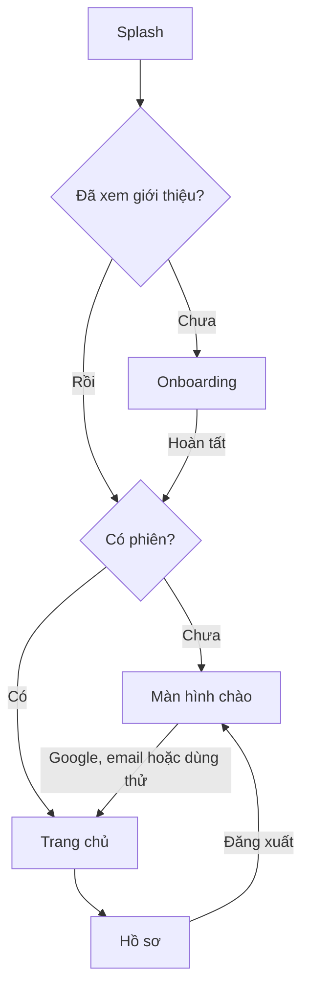

# UTH Todo

Ứng dụng Android Kotlin + Jetpack Compose, triển khai theo từng bài tập của môn Lập trình di động.

- **BTVN 01:** Splash, ba trang onboarding, Navigation/OOP; đã commit/push ở `c4a0623`. Người dùng đã báo chạy thử thành công.
- **BTVN 02:** đã bổ sung mã Google/email, dùng thử, trang chủ sau đăng nhập, hồ sơ và đăng xuất. **Ngày 20/11, người dùng xác nhận đã kiểm thử lại thành công, bao gồm Google sau sửa. Sẵn sàng commit/push trên `feature/btvn02-firebase-auth`.**

Build trước sửa Google đã có `BUILD SUCCESSFUL`, 19 unit Gradle đạt và lint 0 lỗi/23 warning. Sau đó đã chuyển nút Google sang `GetSignInWithGoogleOption`, xử lý riêng thiếu tài khoản và thêm log loại lỗi `UthGoogleAuth`; Google client biên dịch riêng được, 12 unit Auth chạy riêng đạt. Kết quả chạy app sau sửa Google được người dùng xác nhận thành công; agent không tự thao tác tài khoản Google trên thiết bị.

Xem [báo cáo BTVN 02](docs/BTVN02-REPORT.md), [lộ trình nhánh](docs/BRANCH-ROADMAP.md) và [báo cáo BTVN 01](docs/BTVN01-REPORT.md).

## Chức năng

- Splash và onboarding có Tiếp tục, Bỏ qua, Bắt đầu ngay, vuốt, Back và saved state.
- DataStore lưu hoàn tất onboarding, độc lập với phiên đăng nhập.
- Google qua Credential Manager và Firebase Auth; email có đăng nhập, đăng ký, gửi email đặt lại mật khẩu.
- Dùng thử bằng phiên Guest trong tiến trình, không tạo tài khoản Firebase giả.
- Home tối thiểu của BTVN 02 và hồ sơ lấy tên/email/UID/xác minh từ Firebase User.
- Chặn bấm lặp, xử lý hủy Google, lỗi và timeout; đăng xuất dọn Back stack.
- Chuỗi tiếng Việt trong resources, nội dung cuộn cho màn hình nhỏ, bàn phím và font lớn.

API công việc, thống kê, CRUD và các dịch vụ Firebase ngoài Auth thuộc các mốc sau, chưa được triển khai ở BTVN 02.

## Luồng



Firebase SDK khôi phục phiên thật. Guest không lưu qua lần khởi động mới của tiến trình. Profile Back về Home; đăng xuất xóa Home/Profile khỏi stack. Cờ onboarding không phải trạng thái đăng nhập.

## Cấu hình Firebase

Người dùng đã bổ sung `app/google-services.json`; đã kiểm tra file khớp package `com.example.uth_todo` và có Google Web OAuth client. Việc đăng nhập thật vẫn cần chạy thử. Khi cài trên máy khác chưa có config, chế độ khách vẫn dùng được và đăng nhập thông báo chưa sẵn sàng.

1. Mở [Firebase Console](https://console.firebase.google.com/), tạo/chọn dự án UTH Todo và đăng ký Android package `com.example.uth_todo`.
2. Trong Terminal Android Studio chạy `.\gradlew.bat signingReport`; thêm SHA-1/SHA-256 debug vào Android app Firebase.
3. Authentication → Sign-in method: bật Google và Email/Password.
4. Tải lại `google-services.json` sau khi bật Google, đặt tại `app/google-services.json`.
5. Sync Gradle, Run trên thiết bị có Google Play services và tài khoản Google để thử Google sign-in.

Cần config Android của UTH Todo, không phải JSON Admin SDK/service account hoặc file English Battle. Google Services plugin áp dụng khi file module tồn tại; không cần sửa SDK path/JDK. File cấu hình riêng được Git bỏ qua.

Google sign-in dùng được trên gói Spark trong hạn mức miễn phí; không cần nâng Blaze chỉ để thử tính năng này. File config hiện tại chỉ có OAuth Web (client type 3), vì vậy cần đối chiếu SHA-1 debug trong Project settings → Android app rồi tải lại config nếu đã thay đổi. Việc không thấy OAuth Android trong file không chứng minh cấu hình trên Console bị thiếu; cần kiểm tra trực tiếp. Thiết bị cần có Google Play services và tài khoản Google sử dụng được.

Nếu còn lỗi sau khi Run lại, đọc Logcat với tag `UthGoogleAuth`; log chỉ ghi loại lỗi, không ghi token hoặc tài khoản. Nguồn giá: [Firebase Pricing](https://firebase.google.com/pricing).

Nguồn: [Firebase Android setup](https://firebase.google.com/docs/android/setup), [Google sign-in](https://firebase.google.com/docs/auth/android/google-signin).

## Cấu hình và kiểm tra

Giữ minSdk 24, SDK 37, AGP 9.4.1, Gradle 9.6.0, Kotlin Compose 2.2.10, versionName 1.0, tiêu chí daemon JDK 25 và Java source/target 11. Không sửa `local.properties` hoặc cấu hình máy.

Dependency mới trong version catalog: Firebase BoM 34.7.0/Auth 24.0.1 main module, Google Services 4.6.0, Credentials 1.6.0, Google ID 1.1.1, coroutine Play Services 1.10.2. BoM được giữ ở phiên bản này để tránh Auth 25.0.0 có Kotlin metadata 2.4 không khớp compiler Kotlin 2.2 hiện tại; không nâng Kotlin/SDK để xử lý lỗi dependency.

```powershell
.\gradlew.bat assembleDebug testDebugUnitTest lintDebug
```

Khi thiết bị ADB đã kết nối:

```powershell
.\gradlew.bat connectedDebugAndroidTest
```

| Kiểm tra lần BTVN 02 | Kết quả |
|---|---|
| Biên dịch riêng AuthSession/AuthRepository/AuthViewModel/AuthViewModelTest bằng Kotlin 2.2.10 có sẵn | Đạt |
| JUnit AuthViewModelTest với dependency đã có | 10/10 đạt |
| assembleDebug / testDebugUnitTest / lintDebug, lần người dùng chạy lại ngày 20/11 | BUILD SUCCESSFUL trong 15 giây; 19 unit test đạt, lint 0 lỗi/23 warning |
| Wrapper trong môi trường agent sau sửa lint | Bị chặn trước biên dịch: Access is denied ở file khóa wrapper |
| UI, Firebase thật, Google chooser | Chưa kiểm chứng |

JUnit riêng dùng fake repository, không chứng minh Firebase thật. APK đã qua assembleDebug ở lần chạy của người dùng; Google/email thật vẫn cần thử trên thiết bị. Bộ UI test không mở tài khoản Google và không xóa dữ liệu app của người dùng.

## Cấu trúc

Các đường dẫn Kotlin tính từ `app/src/main/java/com/example/uth_todo/`.

| Thành phần | Trách nhiệm |
|---|---|
| `MainActivity.kt` | Một Activity, system splash, factory ViewModel |
| `navigation/` | Destination, NavHost, điều hướng theo onboarding/phiên |
| `model/` | Dữ liệu trang, phiên, hồ sơ, lỗi và thông báo |
| `data/preferences/` | Cờ onboarding trong DataStore |
| `data/auth/` | Hợp đồng xác thực, Firebase repository, Credential Manager |
| `ui/auth/` | Form email, ViewModel, ánh xạ thông báo |
| `ui/home/`, `ui/profile/` | Home BTVN 02, hồ sơ thật/khách |
| `ui/onboarding/`, `ui/splash/`, `ui/welcome/` | Khởi động, giới thiệu, chọn đăng nhập |
| `ui/components/`, `ui/theme/` | Thành phần và minh họa offline dùng lại |

## Nghiệm thu

- Kiểm tra lại onboarding: Tiếp tục/vuốt/Back/xoay/Bỏ qua/Bắt đầu ngay.
- Không có config: không crash; dùng thử → Home → hồ sơ khách → Đăng nhập để quay về Welcome.
- Có config: đăng ký/email/Google, kiểm tra người dùng trong Firebase Authentication → Users và UID/email trong hồ sơ.
- Thử dữ liệu sai, mật khẩu sai, email trùng, quên mật khẩu, hủy Google và bấm nhanh.
- Mở lại app đã đăng nhập → Home; đăng xuất rồi Back không vào Home/Profile.
- Thử font lớn, landscape, màn hình nhỏ và bàn phím mở.

Nếu muốn xem lại onboarding từ đầu, người dùng tự Clear storage/gỡ app và chấp nhận mất dữ liệu cục bộ. Agent không reset dữ liệu.
